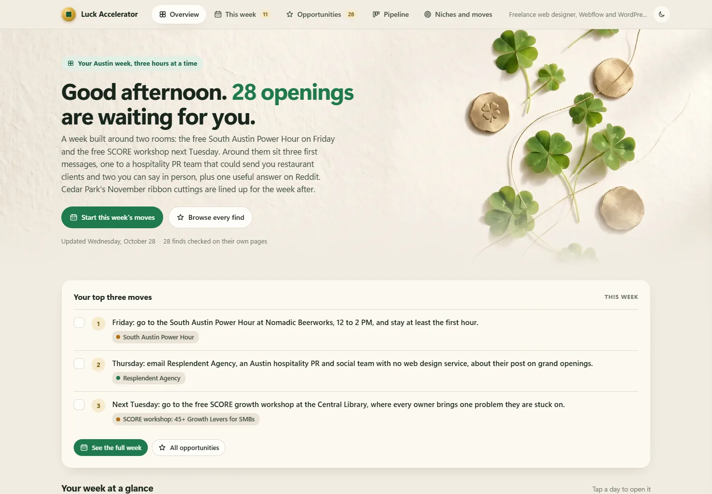
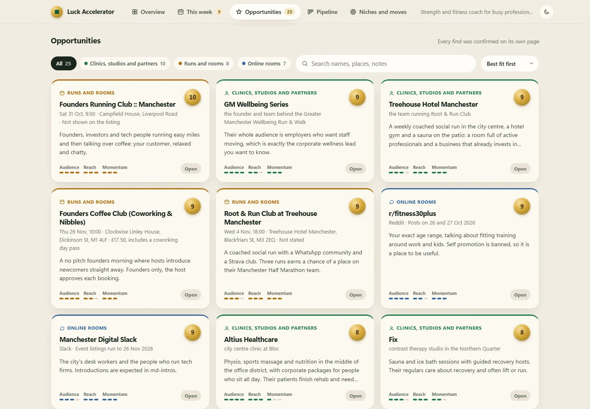
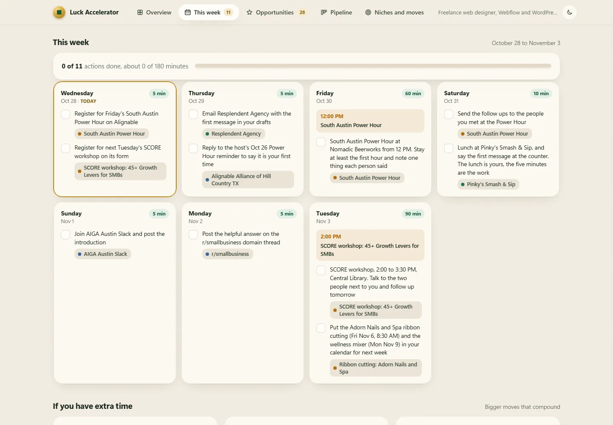

<h1 align="center">Luck Accelerator</h1>

<h3 align="center">Luck favors movement.</h3>
<p align="center">A free Claude skill that finds the people, events and communities worth meeting this week, writes the first message for each one, and keeps it all in your own luck dashboard. Every week it finds new openings. You do the moving.</p>

<p align="center">
  
  
  
</p>

<p align="center">
  <a href="https://club.reinventing.ai/luck-accelerator?utm_source=github&utm_medium=readme&utm_campaign=luck-accelerator&utm_content=nav-guide"><strong>Setup guide and download</strong></a>
  &nbsp;&bull;&nbsp;
  <a href="https://club.reinventing.ai/?utm_source=github&utm_medium=readme&utm_campaign=luck-accelerator&utm_content=nav-club"><strong>Agent Ops Club</strong></a>
  &nbsp;&bull;&nbsp;
  <a href="https://club.reinventing.ai/software?utm_source=github&utm_medium=readme&utm_campaign=luck-accelerator&utm_content=nav-software"><strong>More free software</strong></a>
</p>

<p align="center">
  
</p>

## What it does

Most new customers and partners come from a conversation someone started. This skill makes it easy to start more of them. Tell it where you are, what you sell and who you want to meet, and it:

- **Finds high value local connections.** Business owners who just opened, referral partners who serve the same customers you do, and the connectors whose job is meeting people.
- **Finds local events that match your interests.** Meetups, chamber breakfasts, coworking nights, workshops and conferences in the next 30 days, with dates and prices checked on the event page.
- **Finds online networks.** Skool communities, subreddits, Discord and Slack groups, forums and newsletters where your customers already spend time.
- **Spots sub niches.** Narrower slices of your market where your offer stands out, with the evidence for each.
- **Writes the outreach.** A short, friendly first message for every top pick, a conversation starter for every event, and an introduction post for every community. Conversation first, never a cold pitch.
- **Proposes groups to join.** The local groups and Skool communities worth showing up in every week.
- **Plans your week.** A seven day movement plan that fits the hours you have.

Every find is scored out of 10 for fit and links to the page it came from. Before you see anything, the skill checks every link and every draft.

## Your luck dashboard

Everything lands in a dashboard that lives on your computer, shaped around your city, your niche and your goals.

- **Your luck map.** Every find on one chart. The closer to the centre, the better the fit. New finds glow.
- **Top three moves** for the week, and a day by day plan with real event dates and a checkbox for every action.
- **Opportunities** you can filter, search and sort, each with why it fits, where it came from and how to reach them.
- **Drafts ready to copy.** One click copies a message and opens their contact page. You make it yours and send it yourself.
- **Your calendar, done for you.** Add any event to Google Calendar in one click, or download it for Apple Calendar and Outlook. Put the whole week in your calendar, with a daily block for your moves.
- **Follow ups that come to you.** Set a reminder for any find, get a friendly nudge already written, and see every follow up that is due the moment you open the dashboard.
- **Prep cards and directions.** Print a one page card before an event, with your intro line and your opener, and get directions in one tap.
- **Export to a spreadsheet** whenever you want your finds in Google Sheets, Excel or a CRM.
- **A pipeline** from saved, to messaged, to replied, to met.
- **Luck you earn.** A move is worth 1, a reply 3, a meeting 5, and a weekly streak keeps you going.
- **Insights** that spot patterns across your finds, like two partners on the same street or one event that covers three of your top picks.

<p align="center">
  
</p>

<p align="center">
  
</p>

## It keeps finding new openings

After your first run, the skill offers to refresh itself on a schedule: every Monday morning, or whatever suits you. Each refresh reads what you did, skips anything you already acted on, keeps what you saved, finds new people, events and communities, and updates your dashboard. In the Claude desktop app it uses the app's own scheduled tasks. Your folder keeps its own history, so you can look back and see how your luck grew.

## See it first

Two full example runs, one in the US and one in the UK. Download the repo and open either `dashboard/index.html` to explore them.

- [A web designer in Austin, Texas](examples/austin-web-designer/runs/2026-10-28/report.md)
- [A strength coach in Manchester, UK](examples/manchester-fitness-coach/runs/2026-10-28/report.md)

## Install it

**The easy way.** Open the Claude desktop app, go to the **Code** tab, pick any folder, and paste this:

```
Install the Luck Accelerator skill for me from
https://github.com/markfulton/luck-accelerator
Put the whole folder in my skills folder as luck-accelerator
(for the Claude desktop app that is ~/.claude/skills/luck-accelerator),
keep every file, and check that SKILL.md is there.
Then run the luck accelerator for me.
```

It works the same way in the Codex app, Antigravity and Cursor. Your agent does the setup.

**Prefer a download?** Get the ZIP, the same install prompt and the setup guide with a free Agent Ops Club account at [club.reinventing.ai/luck-accelerator](https://club.reinventing.ai/luck-accelerator?utm_source=github&utm_medium=readme&utm_campaign=luck-accelerator&utm_content=install). Extract it, then paste the prompt above with the folder path in place of the link.

## Use it

Say **"run the luck accelerator"** to your agent.

It starts from what your agent already knows about you and your business, shows you a short profile to confirm, and asks only for what is missing: usually your hours a week and anything off limits. Then it researches, ranks, writes, checks, and opens your dashboard. Then:

- **"Open my luck dashboard"** opens it again any time, with your progress saved.
- **"Run the luck accelerator again"** finds new openings now.
- **"Schedule the luck accelerator"** sets or changes the weekly refresh.

## What it never does

- It never sends a message, posts, comments, joins a group, RSVPs, follows or connects for you. You do every action yourself, by hand. A first message lands because a real person sent it.
- It never automates LinkedIn, Facebook, Reddit, Discord, Skool, Meetup or any other platform.
- It never logs in to anything and never reads pages behind a login.
- It only lists people in their public business role, linked to their business or event page. No personal profiles, no home addresses, no personal phone numbers.
- It never invents a find. If it could not confirm something on a real page during the run, it is not in your dashboard.
- It never sets a schedule without asking you first.

## Your data stays on your computer

Your answers, your runs, your progress and your dashboard are plain files in a `luck-accelerator` folder of your own. The dashboard runs on your computer only and loads nothing from the internet. Its history is kept by your computer and never uploaded. The only thing that leaves your computer is the web searches your agent app runs, and the skill keeps those to your city, your niche and public names. More in [PRIVACY.md](PRIVACY.md).

## What is inside

| File | What it does |
|---|---|
| `SKILL.md` | The instructions your agent follows |
| `routines/refresh.md` | The scheduled refresh |
| `reference/sources.md` | Where to look for each kind of find, by country |
| `reference/outreach.md` | How every draft is written, with a worked example |
| `templates/data-schema.md` | The one file each run writes, and how the dashboard is personalized |
| `dashboard/` | The luck dashboard template, its artwork and its small local server |
| `scripts/build.mjs` | Checks a run, writes the report and updates your dashboard |
| `scripts/check-links.mjs` | Checks every link before you see it |
| `scripts/copy-check.mjs` | Checks every draft against the outreach rules |
| `examples/` | Two complete example runs with their dashboards |

## Where this comes from

Created by Mark Fulton of Reinventing.AI, an AI agent and app developer and the founder of Vibe Coding is Life, a Facebook community of 340,000+ people building with AI.

**Want more free tools like this one?** They are in the [Agent Ops Club software library](https://club.reinventing.ai/software?utm_source=github&utm_medium=readme&utm_campaign=luck-accelerator&utm_content=more-software), free with an account.

**Ready to have AI agents installed and working in your business?** That is what the [Agent Ops Club](https://club.reinventing.ai/?utm_source=github&utm_medium=readme&utm_campaign=luck-accelerator&utm_content=next-step) is for.

## License

MIT. Use it, change it, share it. See [LICENSE](LICENSE).
