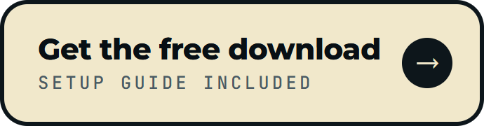
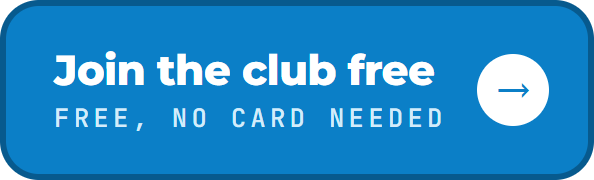
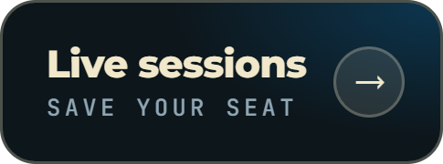
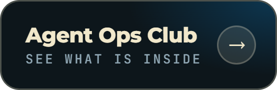

<p align="center">
  <picture>
    <source media="(prefers-color-scheme: dark)" srcset="assets/logo-dark.png">
    
  </picture>
</p>

<h3 align="center">Find who to meet this week. Your agent writes the first message.</h3>
<p align="center">Local people, events and online rooms, ranked for you and checked on their own pages, in your own luck dashboard. Events go straight into your calendar. You make every move.</p>

<p align="center">
  <a href="https://club.reinventing.ai/luck-accelerator?utm_source=github&utm_medium=readme&utm_campaign=luck-accelerator&utm_content=nav-guide"><strong>Setup guide and download</strong></a>
  &nbsp;&bull;&nbsp;
  <a href="https://club.reinventing.ai/?utm_source=github&utm_medium=readme&utm_campaign=luck-accelerator&utm_content=nav-club"><strong>Agent Ops Club</strong></a>
  &nbsp;&bull;&nbsp;
  <a href="https://club.reinventing.ai/ai-employees?utm_source=github&utm_medium=readme&utm_campaign=luck-accelerator&utm_content=nav-employees"><strong>AI Employees</strong></a>
  &nbsp;&bull;&nbsp;
  <a href="https://club.reinventing.ai/events?utm_source=github&utm_medium=readme&utm_campaign=luck-accelerator&utm_content=nav-sessions"><strong>Live sessions</strong></a>
  &nbsp;&bull;&nbsp;
  <a href="https://club.reinventing.ai/software?utm_source=github&utm_medium=readme&utm_campaign=luck-accelerator&utm_content=nav-software"><strong>More free software</strong></a>
</p>

<p align="center">
  
  
  
  
  
</p>

<p align="center">
  <a href="https://club.reinventing.ai/luck-accelerator?utm_source=github&utm_medium=readme&utm_campaign=luck-accelerator&utm_content=btn-download"></a>
  <a href="https://club.reinventing.ai/register?utm_source=github&utm_medium=readme&utm_campaign=luck-accelerator&utm_content=btn-join"></a>
  <a href="https://club.reinventing.ai/events?utm_source=github&utm_medium=readme&utm_campaign=luck-accelerator&utm_content=btn-sessions"></a>
  <a href="https://club.reinventing.ai/?utm_source=github&utm_medium=readme&utm_campaign=luck-accelerator&utm_content=btn-club"></a>
</p>

<p align="center">
  <a href="https://club.reinventing.ai/luck-accelerator?utm_source=github&utm_medium=readme&utm_campaign=luck-accelerator&utm_content=hero"></a>
</p>

<p align="center">
  ⭐ <em>Found something useful? Star the repo. It takes a second and helps the next person find it.</em>
</p>

## Luck Accelerator

Luck favors movement. Most new customers and partners come from a conversation someone started, and most people start too few of them because finding the right rooms takes hours.

Tell your agent where you are and who you want to meet. The Luck Accelerator finds the people, events and online communities worth your time, scores each one for fit, writes a short first message for every top pick, and hands you a seven day plan sized to the hours you have. Then it keeps finding new openings every week.

Created by [Mark Fulton](https://www.reinventing.ai/?utm_source=github&utm_medium=readme&utm_campaign=luck-accelerator) of Reinventing.AI, an AI agent and app developer and the founder of Vibe Coding is Life, a Facebook community of 340,000+ people building with AI.

## Install in two steps

1. **Open your agent app.** The Claude desktop app's **Code** tab, the Codex app, Antigravity or Cursor. Pick any folder.
2. **Paste this prompt.** Your agent installs the skill and runs it for you.

```
Install the Luck Accelerator skill for me from
https://github.com/markfulton/luck-accelerator
Put the whole folder in my skills folder as luck-accelerator
(for the Claude desktop app that is ~/.claude/skills/luck-accelerator),
keep every file, and check that SKILL.md is there.
Then run the luck accelerator for me.
```

<table>
<tr><td align="center" width="900">

<p><b>Prefer a download, with the setup guide and a copy of the prompt by email?</b></p>

<p>Get the ZIP with a free Agent Ops Club account. Extract it, then paste the prompt above with your folder path in place of the link.</p>

<p><a href="https://club.reinventing.ai/luck-accelerator?utm_source=github&utm_medium=readme&utm_campaign=luck-accelerator&utm_content=install-download"><b>Get the free download</b></a></p>

</td></tr>
</table>

## What it finds

| | What you get |
|---|---|
| **People worth knowing** | Owners who just opened, partners who already serve your customers, and the connectors whose job is meeting people |
| **Rooms to walk into** | Meetups, chamber breakfasts, coworking nights and workshops, with dates and prices checked on the event page |
| **Online rooms** | Skool groups, subreddits, Discord and Slack communities, forums and newsletters where your customers already talk |
| **Sub niches** | Narrower slices of your market where your offer stands out, each with the evidence behind it |
| **Groups worth joining** | The local groups and communities worth showing up in every week |
| **Outreach, ready to send by you** | A first message for every top pick, a conversation starter for every event, an introduction for every community. No pitch |

Every find is scored out of 10 for fit and links to the page it came from. Before you see anything, the skill checks every link and every draft.

## Your luck dashboard

Everything lands in a dashboard on your own computer, shaped around your city, your niche and your goals: a luck map where the closest dots are the best fits, your top three moves, a day by day plan with real event dates, every find with why it fits and where it came from, a pipeline from saved to met, the luck you earn for every move, and a rotating quote on luck and showing up to start your day.

Your agent puts a **Luck Dashboard** shortcut on your desktop, so your week is one double click away.

<p align="center">
  
</p>

## Every find comes with a next step

- **Add to your calendar.** Google Calendar in one click, or a file for Apple Calendar and Outlook, with your conversation starter and a reminder an hour before.
- **Put the whole week in your calendar.** Every event at its real time, plus one block a day for your moves.
- **Follow ups that come to you.** A reminder for any find with the nudge already written, and every follow up that is due waiting when you open the dashboard.
- **Copy the message and open their contact page** in one click. You make it yours and send it yourself.
- **Directions and a prep card.** Directions in one tap, and a one page card to print or save before an event, with your intro line and your opener.
- **Export to a spreadsheet** for Google Sheets, Excel or your CRM.

<p align="center">
  
</p>

## It keeps finding new openings

After your first run, the skill offers to refresh itself every Monday morning, or on any schedule you pick. Each refresh reads what you did, skips anything you already acted on, keeps what you saved, and adds new people, events and communities. In the Claude desktop app it uses the app's own scheduled tasks.

## Use it

Say **"run the luck accelerator"** to your agent. It starts from what your agent already knows about you, shows you a short profile to confirm, and asks only for what is missing. Then:

- **"Open my luck dashboard"** opens it again any time, with your progress saved.
- **"Run the luck accelerator again"** finds new openings now.
- **"Schedule the luck accelerator"** sets or changes the weekly refresh.

## See it first

Two full example runs. Download the repo and open either `dashboard/index.html` to explore them.

- [A web designer in Austin, Texas](examples/austin-web-designer/runs/2026-10-28/report.md)
- [A strength coach in Manchester, UK](examples/manchester-fitness-coach/runs/2026-10-28/report.md)

## What it never does

- It never sends a message, posts, comments, joins a group, RSVPs, follows or connects for you. A first message lands because a real person sent it.
- It never automates LinkedIn, Facebook, Reddit, Discord, Skool, Meetup or any other platform.
- It only reads. It can use a browser to look, never to sign in for you or change anything in your accounts.
- It only lists people in their public business role, linked to their business or event page.
- It never invents a find. If it could not confirm something on a real page during the run, it is not in your dashboard.
- It never sets a schedule or touches your calendar without your yes.

## Your data stays on your computer

Your answers, runs, progress and dashboard are plain files in a `luck-accelerator` folder of your own. The only file it adds outside that folder is the desktop shortcut. The dashboard runs on your computer only and loads nothing from the internet. The only thing that leaves your computer is the web searches your agent app runs, kept to your city, your niche and public names. More in [PRIVACY.md](PRIVACY.md).

## FAQ

<details>
<summary><b>Is it free?</b></summary>

Yes. MIT licensed, free to use and change. The ZIP download on the club takes a free account; the install prompt above works straight from GitHub.
</details>

<details>
<summary><b>Which apps does it work in?</b></summary>

The Claude desktop app (Code tab) and Claude Code, the Codex app, Antigravity and Cursor: any agent app that can use skills, search the web and run a small script.
</details>

<details>
<summary><b>Does it message people for me?</b></summary>

Never. It drafts, ranks and plans. You send every message, join every group and register for every event yourself.
</details>

<details>
<summary><b>Can it add events to my calendar?</b></summary>

Yes. Every event has an Add to Google Calendar button and a file for Apple Calendar and Outlook, and the week view exports your whole week. If your agent app has a calendar connector, it can add them for you after you say yes.
</details>

<details>
<summary><b>Does it work outside the US?</b></summary>

Yes. The example runs are in Austin and Manchester, and it searches in your local language where that helps. Online only works too.
</details>

## What is inside

| File | What it does |
|---|---|
| `SKILL.md` | The instructions your agent follows |
| `routines/refresh.md` | The scheduled weekly refresh |
| `reference/sources.md` | Where to look for each kind of find, by country |
| `reference/outreach.md` | How every draft is written, with a worked example |
| `templates/data-schema.md` | The one file each run writes, and how the dashboard is personalized |
| `dashboard/` | The luck dashboard, its artwork and its small local server |
| `scripts/build.mjs` | Checks a run, writes the report and updates your dashboard |
| `scripts/check-links.mjs` | Checks every link before you see it |
| `scripts/copy-check.mjs` | Checks every draft against the outreach rules |
| `scripts/shortcut.mjs` | Puts the Luck Dashboard shortcut on your desktop (Windows, macOS, Linux) |
| `examples/` | Two complete example runs with their dashboards |

## Go further

**The Luck Accelerator finds the conversations.** The [eight open source AI Employees](https://club.reinventing.ai/ai-employees?utm_source=github&utm_medium=readme&utm_campaign=luck-accelerator&utm_content=go-further) run the rest of the work on a schedule, from sales follow ups to your weekly scoreboard, free on every plan.

**Want agents installed and working in your business?** That is what the [Agent Ops Club](https://club.reinventing.ai/?utm_source=github&utm_medium=readme&utm_campaign=luck-accelerator&utm_content=go-further-club) is for: the Masterclass, live sessions, the premium software library and the AI Employees, set up step by step.

## License

MIT. Use it, change it, share it. See [LICENSE](LICENSE).
